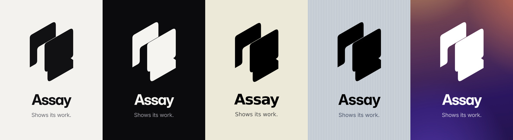
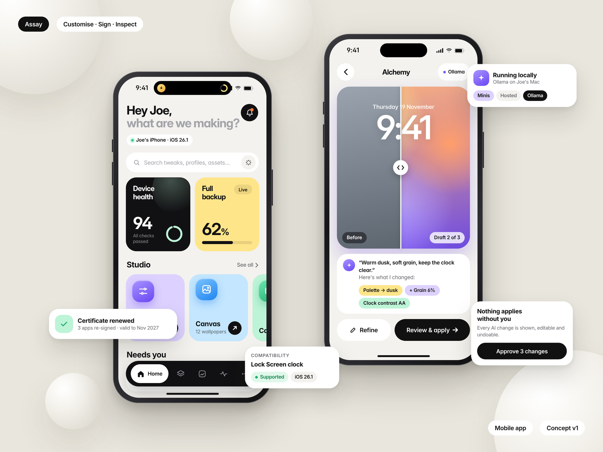

# Assay

**Shows its work.** A workbench for making things on your iPhone and checking what changed.

[Field guide](docs/wiki/Home.md) · [Design & motion](docs/wiki/Design-and-motion.md) · [Current app screens](docs/app-screens/README.md)

## Home & Alchemy

*Original concept · tap the artwork for both screens.*

<a href="docs/identity/repo/home-alchemy.jpg"><picture><source media="(max-width: 540px)" srcset="docs/identity/repo/home-mobile.jpg"></picture></a>

A charcoal device card next to a yellow backup card. A row of Studio tools below. In Alchemy, the split runs through the same clock on both versions of the wallpaper, so you can see what an edit does to its legibility. [Watch the original film (8 s)](docs/motion/home-alchemy.mp4).

## What you can try in build 8

- **Make a scene.** Pick five colours, preview them in Assay and undo the change. Use a layout recipe when you’re ready to place icons and widgets by hand. [Scenes and layouts →](docs/wiki/Scenes.md)
- **Edit artwork.** Replace a layer in a Canvas project or export an image from Cards. The original project stays intact. [Studio →](docs/features/studio-and-team.md)
- **Check your device.** Compare the clock you see with device time, read a crash report, or inspect an app and its widget before signing. [Diagnostics →](docs/wiki/Start-and-diagnostics.md) · [Signing & permissions →](docs/wiki/Signing-and-permissions.md)

The live backup percentage and certificate renewal in the artwork are **concept examples**. Build 8 can [checkpoint selected files](docs/wiki/File-Vault.md) and hand a standard USB backup request to a trusted Mac. It does not provide a protective system rollback, re-sign apps in Assay, or repair protected settings on a real phone.

**Developer preview:** 0.3.0 (8) · iPhone · iOS 17+. [20 November readiness review and remaining limits](docs/audit/READINESS-20NOV.md). On a Mac with Xcode and XcodeGen, run `xcodegen generate`, open `Assay.xcodeproj`, then choose an iPhone simulator.

[Testing](docs/TESTING.md) · [Request audit](docs/audit/REQUESTS.md) · [Roadmap](docs/ROADMAP.md) · [Original design spec](docs/DESIGN_SPEC.md)

Independent work, with thanks to the GoldenNugget Mobile contributors. [Credits](CREDITS.md) · [Proprietary licence](LICENSE).
