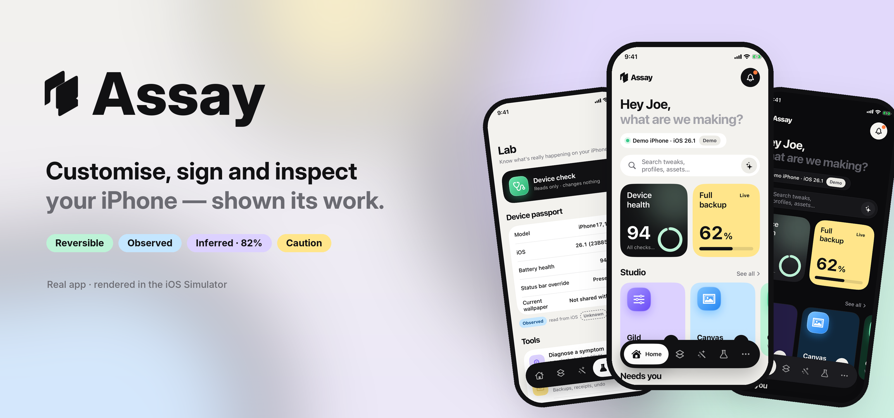
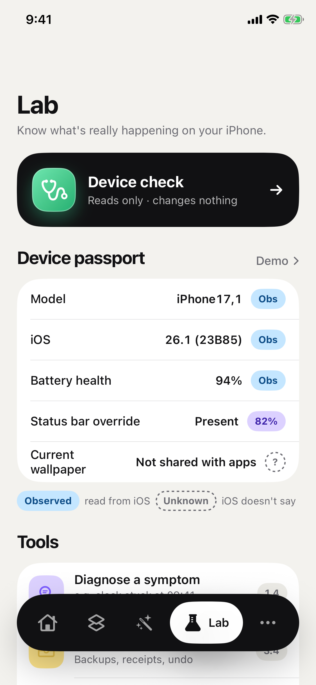
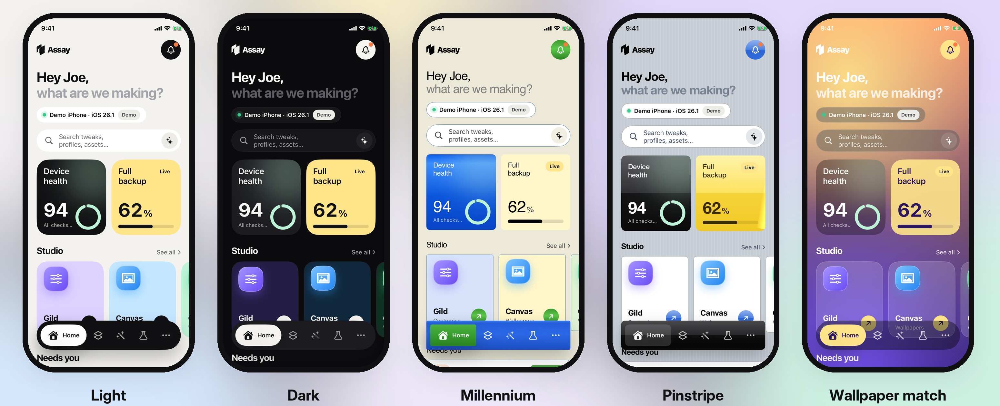
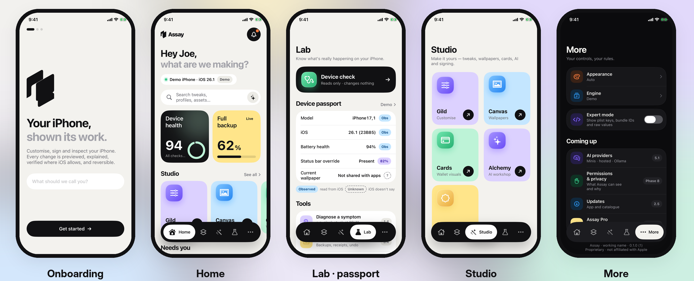
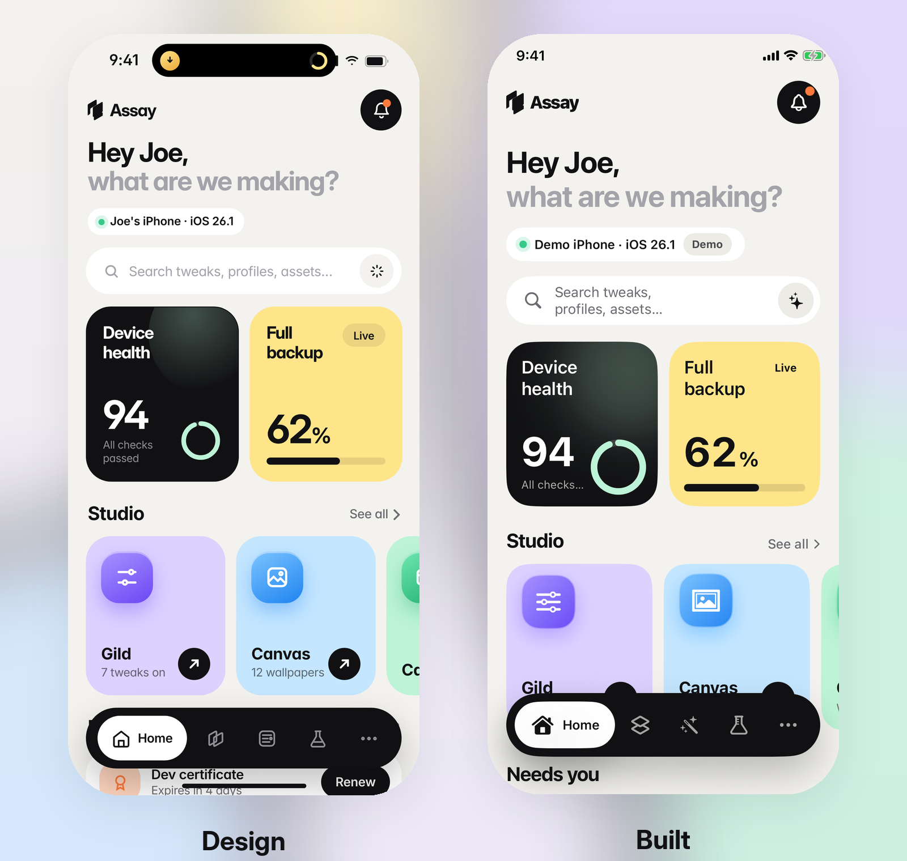

<!-- Working name "Assay". Trademark/App Store/domain availability still to be confirmed. -->
<p align="center">
  
</p>

<p align="center">
  
  
  
  
</p>

<p align="center">
  <a href="docs/features/README.md"><b>Test the four new tools</b></a>&nbsp;&nbsp;·&nbsp;&nbsp;
  <a href="docs/ROADMAP.md"><b>Roadmap</b></a>&nbsp;&nbsp;·&nbsp;&nbsp;
  <a href="docs/app-screens/README.md"><b>App screenshots</b></a>&nbsp;&nbsp;·&nbsp;&nbsp;
  <a href="docs/GALLERY.md"><b>Design gallery</b></a>&nbsp;&nbsp;·&nbsp;&nbsp;
  <a href="docs/DESIGN_SPEC.md">Design spec</a>&nbsp;&nbsp;·&nbsp;&nbsp;
  <a href="docs/TESTING.md">Testing</a>
</p>

<br>

> **Assay** brings tweaks, Scenes, wallpapers, Wallet card art, app signing, diagnostics, Bluetooth and network tools, and AI-assisted creation into one calm iPhone app.
> Every change is **previewed, explained, applied one step at a time, verified where iOS allows it, and reversible.**

<br>

## ✦ Shows its work

<table>
<tr>
<td width="50%" valign="top">

Every fact Assay shows carries where it came from:

| | Means |
|:--|:--|
|  | Read straight from iOS |
|  | Our reasoning, with confidence |
|  | iOS doesn't say — we won't guess |

And every change carries a risk tier:

| | Means |
|:--|:--|
|  | Old value saved; read-back verified |
|  | Version-sensitive; preflight + recovery notes |
|  | Opt-in only, never auto-applied |

</td>
<td width="50%" align="center">

<br><sub><b>Lab</b> — the device passport, every value tagged</sub>
</td>
</tr>
</table>

## ◧ Five themes, one system



Auto follows iOS. **Millennium** and **Pinstripe** are original homages; **Wallpaper match** turns the whole app to glass over your own palette.

## ⌁ On your iPhone, today

**[Try the four device utilities →](docs/features/device-utilities.md)** Compare the live clock, restore an earlier file without overwriting the original, activate a saved Assay scene, or check a signing certificate against target profiles. These actions do not need a pairing record.

For an actual whole-device backup, use **Finder over USB** or the [standalone Mac backup utility](Mac/usb-backup/README.md). This does **not** enable Assay to modify SpringBoard, and is not the future in-app Mac connection. For testing tweak requests without touching system settings, use Demo.

## ⊞ The app



| Module | | What it does | Status |
|:--|:--|:--|:--|
| **Scenes** | ◧ | Wallpaper, layout, widgets, Shortcuts and Focus, saved together · guided apply · snapshots | 🔨 landing |
| **Gild** | ☰ | Tweak catalogue with safety tiers, presets, compatibility, custom builder | Catalogue and staged review · demo writes |
| **Canvas** | ✦ | `.tendies` / Poster projects — layers, timeline, validate, export | ○ Phase 4 |
| **Cards** | ▭ | Wallet card visuals. Visual only — never payment data | ○ Phase 4 |
| **Alchemy** | ✧ | AI assets with Minis, hosted providers or local Ollama | Chat · demo and provider configuration |
| **Signet** | ◎ | In-app installer & signer: per-target profiles, entitlements, expiry | Inspector only · no signing |
| **Lab** | ⊙ | Device check, passport, diagnose, fix flow with receipts | ✅ passport |
| **Vault** | ⬓ | Resumable backups, baseline reuse, honest Live Activity, undo | ○ Phase 3 |
| **Tools** | ⌁ | BLE notebook, Bonjour inventory, TLS certificate check | Simulator preview · hardware tests pending |

## ◎ Design → built

<table>
<tr>
<td width="45%" align="center"></td>
<td width="55%" valign="top">

Every screen is built from the **[Fold design system](docs/DESIGN_SPEC.md)**:

- **Type** — Inter Display headlines, two-tone greetings, tabular numbers
- **Colour** — paper & ink, five pastels, semantic tags that never rely on colour alone
- **Shape** — 28 pt cards, full pills, a floating tab bar that morphs
- **Motion** — springs everywhere, 90 ms staggers, Reduce Motion cross-fades
- **Honesty** — no fake progress, no "Success!" without a read-back

Renders of the real app are regenerated by CI into **[docs/app-screens](docs/app-screens/README.md)**.

</td>
</tr>
</table>

## ⚙ Build

Builds run on GitHub Actions (macOS) and are **manual only**.

| Mode | What you get |
|:--|:--|
| `screenshots` | Every screen rendered in the iOS Simulator, light & dark, committed to `docs/app-screens` |
| `ipa` | `Assay-unsigned.ipa` — sign with your own certificate (or with Signet, once it lands) |

**Actions › Assay iOS CI › Run workflow.** Locally: `brew install xcodegen && xcodegen generate && open Assay.xcodeproj`.

<details>
<summary><b>Repository layout</b></summary>

```
App/
  DesignSystem/   Theme, motion, components (Fold system)
  Shell/          Root, floating tab bar, toasts
  Core/           App state and settings
  Engine/         DeviceEngine protocol · Demo · iPhone · Mac companion
  Features/       Home · Onboarding · Lab · Studio · Scenes · More
docs/
  app-screens/    Real app, rendered by CI
  screens/        Design renders (5 themes)
  brand/          Hero art, lockups, icons
  ROADMAP.md · DESIGN_SPEC.md · PRODUCT_BRIEF.md · TESTING.md
brand/            Fold identity source (SVG, icons)
prototype/        HTML/CSS prototypes
scripts/          screenshots.sh · readme_art.py · typecheck.sh · ci-watch.sh
```

</details>

## ♡ Promises

- **No fake keep-alives.** If iOS pauses a backup, the Live Activity says *Paused by iOS*.
- **No implied entitlements.** Signet shows what Apple needs; it never pretends.
- **No silent changes.** Toggles stage changes; nothing applies until you review.
- **Your keys stay yours.** API keys, pairing records and signing identities live in the Keychain — never in logs, exports or prompts.
- **Authorised scanning only.** Bluetooth and network tools are visible, bounded and stop when you leave.

<br>

---

<p align="center">
  <br>
  <sub>
    Assay is an independent project. Thanks to GoldensHQ and the GoldenNugget Mobile contributors, whose work in the iOS customisation community informed this one — see <a href="CREDITS.md">credits</a>.<br>
    Apple, iPhone, iOS, Wallet, Apple Pay, Live Activities and Dynamic Island are trademarks of Apple Inc. Assay is not affiliated with or endorsed by Apple.<br>
    © 2026 Joe Kane · Proprietary — all rights reserved · <a href="LICENSE">LICENSE</a>
  </sub>
</p>
