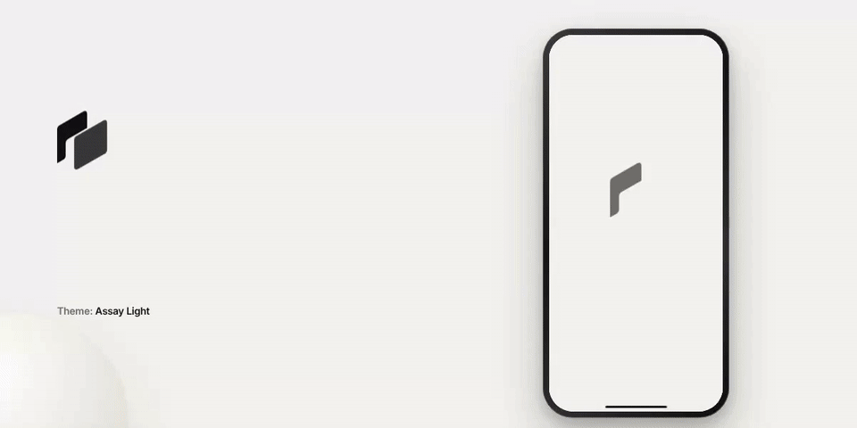
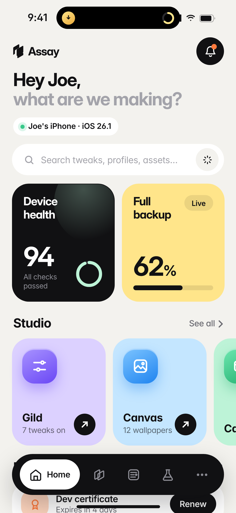
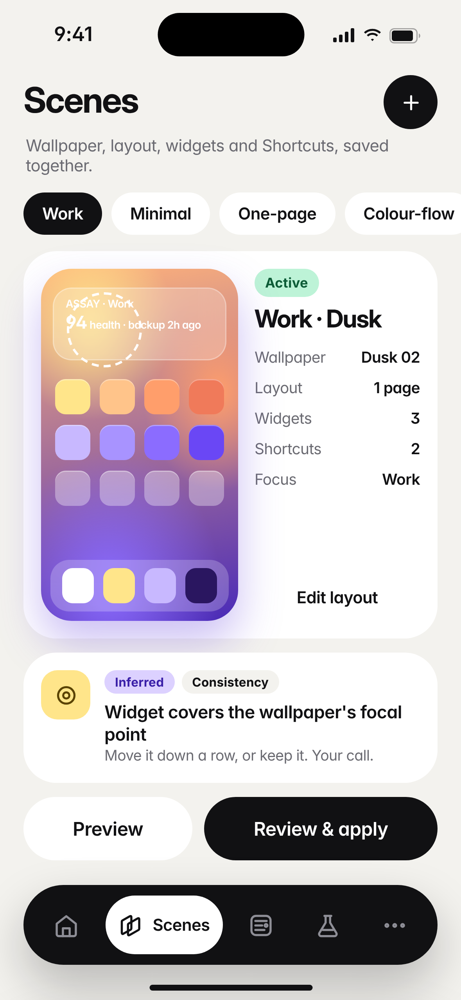
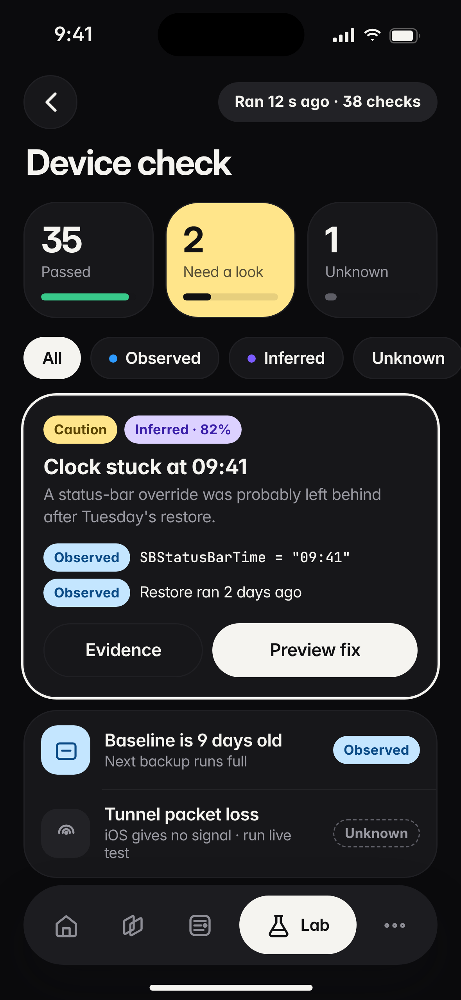
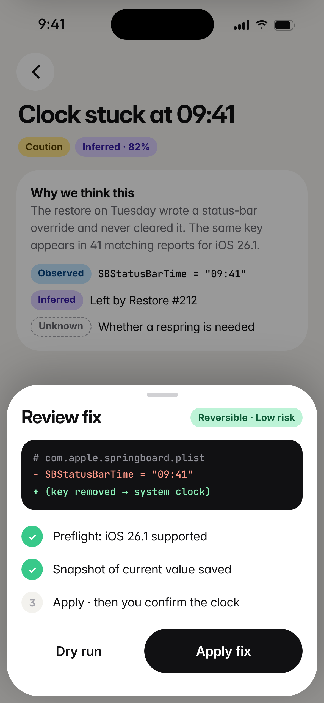
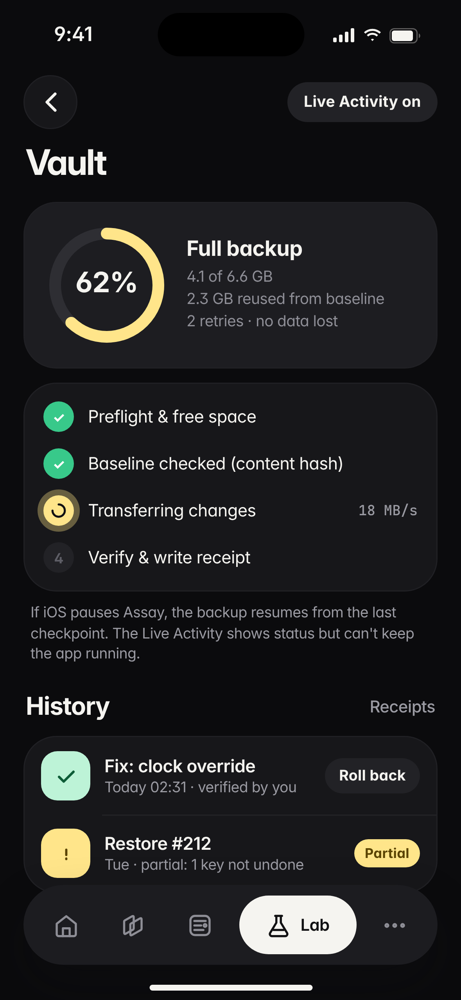

<!-- Working name "Assay". Trademark/App Store/domain availability still to be confirmed. -->
<p align="center"></p>

<p align="center">
  <b>Customise, sign and inspect your iPhone — in one workbench that shows its work.</b>
</p>

<p align="center">
  
  
  
  
</p>

<p align="center">
  <a href="docs/GALLERY.md"><b>Design gallery</b></a> ·
  <a href="docs/ROADMAP.md"><b>Roadmap</b></a> ·
  <a href="docs/PRODUCT_BRIEF.md">Product brief</a> ·
  <a href="docs/DESIGN_SPEC.md">Design spec</a> ·
  <a href="docs/TESTING.md">Testing</a>
</p>

---

<p>
    
</p>
<sub>Design renders from the brand bundle. Screenshots of the real app are added under <code>docs/app-screens/</code> as features land.</sub>

## What it is

Assay brings device tweaks, Scenes, wallpapers and `.tendies`, Wallet card visuals, app signing, diagnostics, Bluetooth and local-network tools and AI-assisted creation into one calm, native-feeling iPhone app.

Every change is **previewed, explained, applied one step at a time, verified where iOS allows it, and reversible**.

| Promise | What it means |
|---|---|
| **Shows its work** | Every finding is labelled **Observed**, **Inferred** or **Unknown**. |
| **Preview before change** | The exact diff, the risk tier and the recovery plan come before anything is applied. |
| **Reversible by default** | Snapshots, receipts and one-tap rollback. If something can't be undone, Assay says so first. |
| **Version-aware** | Every tweak is checked against your exact iOS build and device. |
| **Honest about iOS** | No fake keep-alives, no implied entitlements, no jailbreak-level promises. |
| **You own the AI** | Minis, a hosted provider or local Ollama. AI drafts; you approve. |

## Modules

| | Module | What it does |
|---|---|---|
| ◧ | **Scenes** | Wallpaper, Home Screen layout, widgets, Shortcuts and Focus as one set — recipes, consistency check, guided apply, restore. |
| ☰ | **Gild** · Customise | Tweak catalogue with safety tiers (Reversible · Caution · Experimental), presets, compatibility and a custom builder. |
| ✦ | **Canvas** · Wallpapers | `.tendies` / Poster projects: layers, timeline, validation, preview, export. |
| ▭ | **Cards** · Wallet visuals | Card art editor and previews. Visual only — never payment data. |
| ✧ | **Alchemy** · AI | Provider-neutral asset creation and editing with before/after. |
| ◎ | **Signet** · Signing | Developer account, per-target bundle IDs, entitlements, profiles, expiry and renewal. |
| ⊙ | **Lab** · Device check | One-tap diagnosis, evidence, fix flow with receipts, passport, timeline, crash explainer. |
| ⬓ | **Vault** · Backups | Resumable backups, baseline reuse, honest progress, Live Activity, rollback. |
| ⌁ | **Tools** | BLE notebook and authorised local-network inventory. |

## Engine: your choice

On first run Assay asks how it should reach the device:

| | **Mac companion** | **iPhone only** |
|---|---|---|
| Speed | Fast — USB, no tunnel stalls | Slower — on-device loopback |
| Runs while locked | Yes, the Mac does the work | No, iOS suspends the app |
| Privacy | Data passes through your Mac | Nothing leaves the phone |
| Needs | A Mac with Assay for Mac | A paid developer team for the tunnel |

You can switch any time in **More › Engine**.

## Build

Builds run on GitHub Actions (macOS) and are **manual only** — nothing builds on push.

1. **Actions › Assay iOS CI › Run workflow**.
2. `screenshots` mode renders every screen in the iOS Simulator and uploads them for review.
3. `ipa` mode produces `Assay-unsigned.ipa`; sign it with your own certificate.

Local:

```sh
brew install xcodegen
xcodegen generate
open Assay.xcodeproj
```

## Repository layout

```
App/            SwiftUI app (design system, features, engine, services)
Widgets/        WidgetKit, Live Activity and Control Centre extension   (planned)
Mac/            Assay for Mac companion                                  (planned)
docs/           Brand, design spec, gallery, roadmap, test notes
prototype/      HTML/CSS design prototypes
brand/          Fold identity source (SVG, icons)
design/         Design tokens
scripts/        Typecheck and tooling
```

## Status

Built feature by feature — see the **[roadmap](docs/ROADMAP.md)** for what's live, what's stubbed and how to test each piece.

## Credits

Assay is an independent project. Thanks to GoldensHQ and the GoldenNugget Mobile contributors, whose work in the iOS customisation community informed this one. No GoldenNugget code or branding is included. See [CREDITS.md](CREDITS.md).

Apple, iPhone, iOS, Wallet, Apple Pay, Live Activities and Dynamic Island are trademarks of Apple Inc. Assay is not affiliated with or endorsed by Apple.

## Licence

Proprietary — all rights reserved. See [LICENSE](LICENSE).
