# App screenshots

Rendered by CI in the iOS Simulator (demo engine, 9:41 status bar).

<table><tr><td align="center"> 00-onboarding-dark</td>
<td align="center">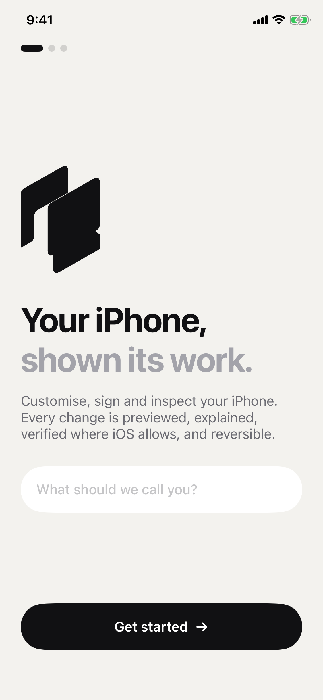 00-onboarding-light</td>
<td align="center">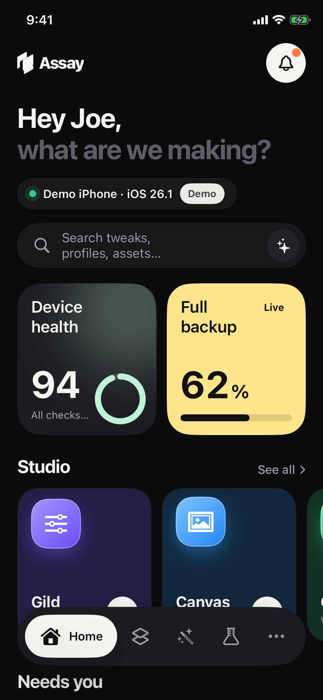 01-home-dark</td>
<td align="center"> 01-home-light</td></tr><tr>
<td align="center">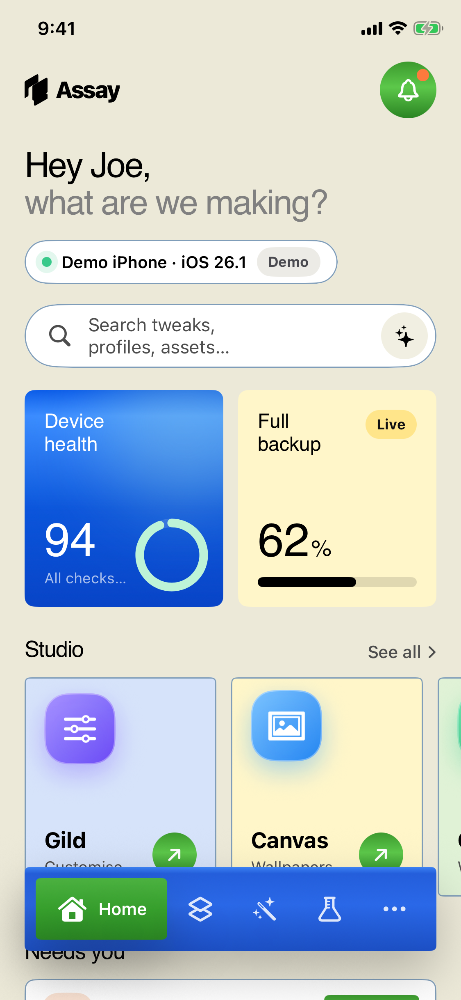 01-home-millennium</td>
<td align="center">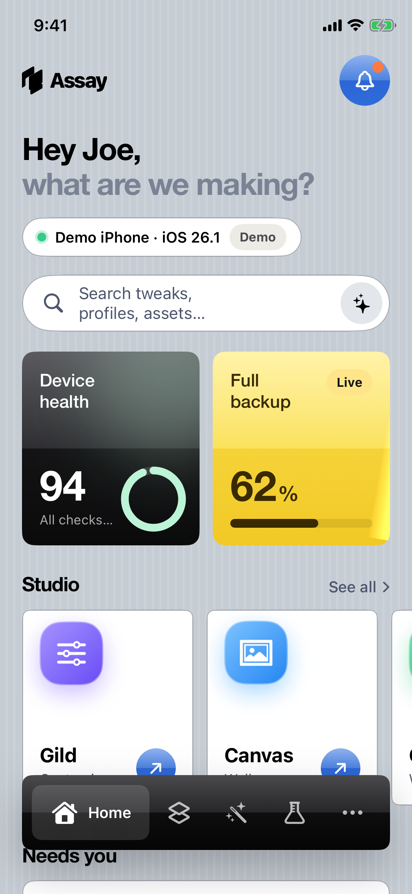 01-home-pinstripe</td>
<td align="center">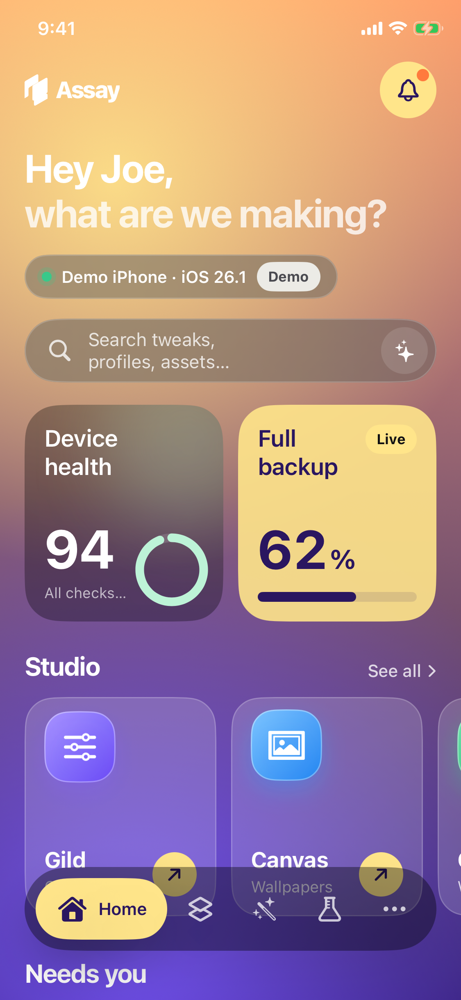 01-home-wallpaper</td>
<td align="center">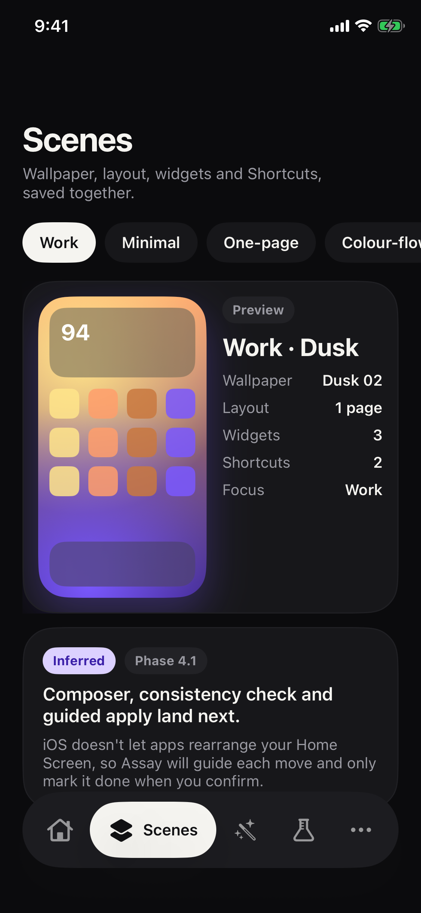 02-scenes-dark</td></tr><tr>
<td align="center">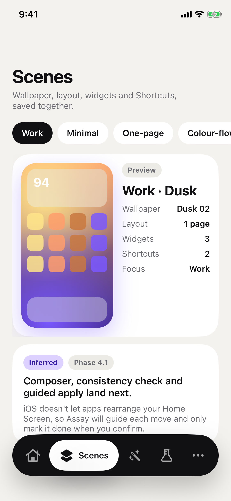 02-scenes-light</td>
<td align="center">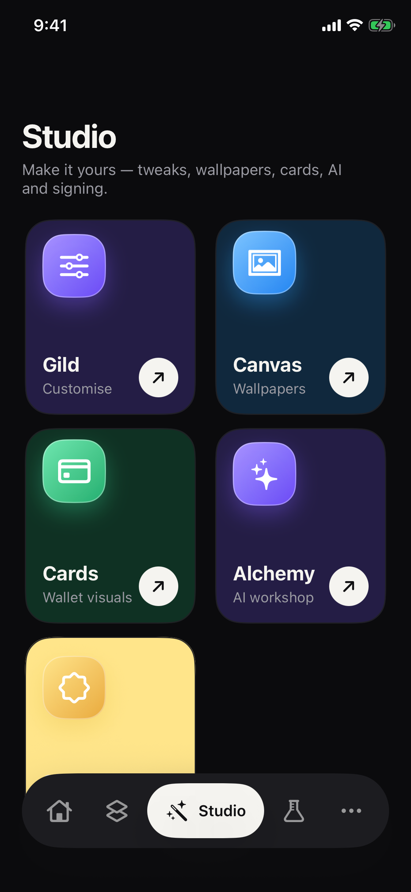 03-studio-dark</td>
<td align="center">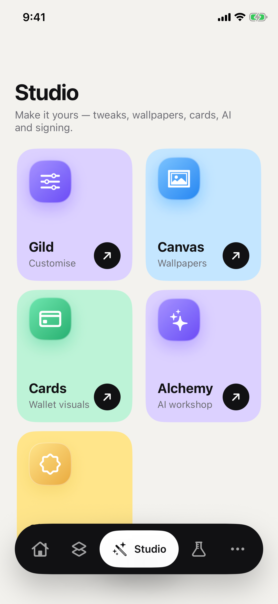 03-studio-light</td>
<td align="center">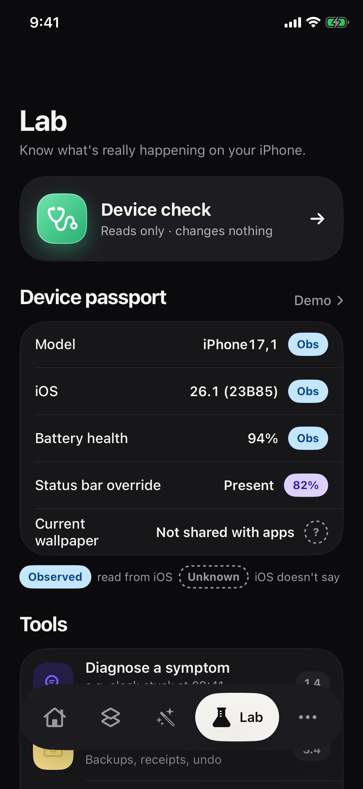 04-lab-dark</td></tr><tr>
<td align="center">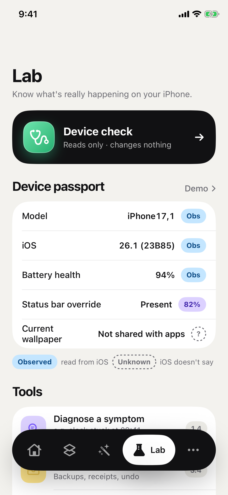 04-lab-light</td>
<td align="center">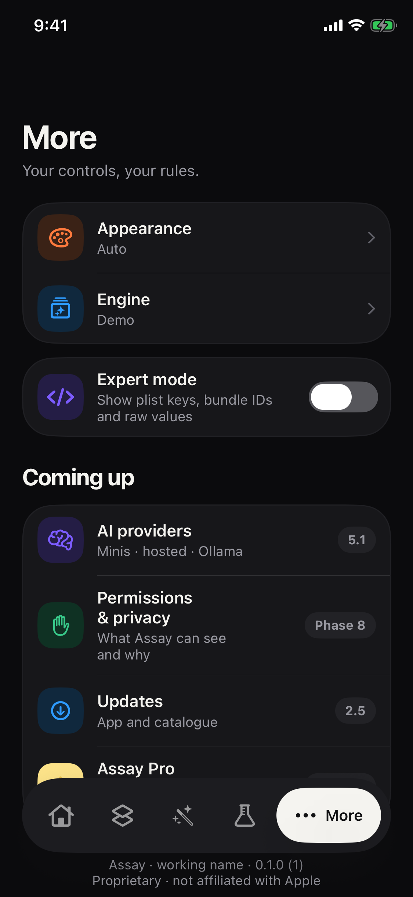 05-more-dark</td>
<td align="center">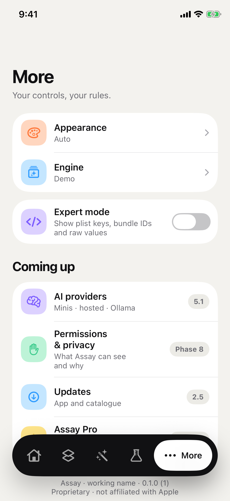 05-more-light</td></tr></table>
