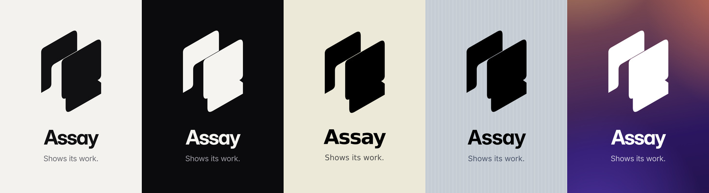
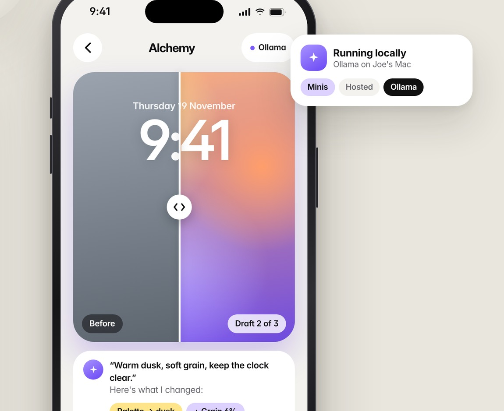

# Design & motion

The original Assay artwork, in stills and short films. These are **design concepts**. For the app as it runs today, use the [build 7 simulator gallery](../app-screens/README.md).

## Five launch screens

Open a full-height original: [Light](../screens/00-launch-light.png) · [Dark](../screens/00-launch-dark.png) · [Millennium](../screens/00-launch-xp.png) · [Pinstripe](../screens/00-launch-ios4.png) · [Wallpaper](../screens/00-launch-wall.png).

## Inside Alchemy

<a href="../identity/repo/home-alchemy.jpg"><picture><source media="(max-width: 540px)" srcset="../identity/repo/alchemy-mobile.jpg"></picture></a>

**“Warm dusk, soft grain, keep the clock clear.”** The split shows the proposed change; the provider label tells you where the request would run. The two original boards differ in the Home tab bar. [First board](../identity/repo/home-alchemy.jpg) · [Alternate tab bar](../identity/repo/home-alchemy-alternate.jpg).

## Five films

Click a title to play its MP4. They do not autoplay.

1. **[Fold launch · 7 s](../motion/logo-launch.mp4)** — light and dark marks give way to Home.
2. **[The five appearances · 13 s](../motion/themes.mp4)** — compare a single Home layout across themes.
3. **[Home & Alchemy · 8 s](../motion/home-alchemy.mp4)** — the wallpaper comparison and its review callouts.
4. **[Diagnose and review a fix · 10 s](../motion/fix-flow.mp4)** — from an observation to a review sheet, then a receipt.
5. **[Home & Alchemy, alternate cut · 8 s](../identity/repo/home-alchemy-alternate.mp4)** — the second supplied rendering of the two-screen composition.

[Back to the field guide](Home.md) · [Read the original design specification](../DESIGN_SPEC.md)
