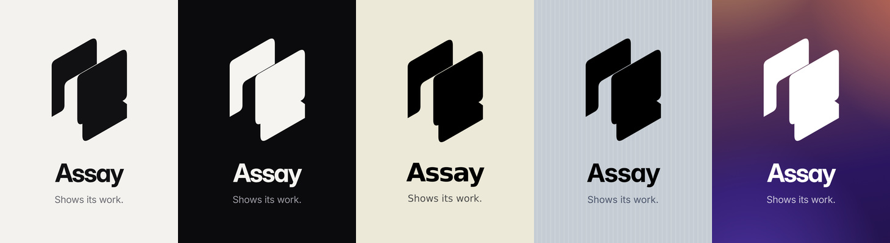

# Assay field guide

[Design and motion](Design-and-motion.md) collects the theme stills and all five concept films, from the colourful Home tiles to Alchemy’s before-and-after at dusk. These are design studies; the guides below describe the app.

## Use the developer preview

iPhone · iOS 17 or later · Assay 0.3.0 (7)

For readings from your phone, choose **iPhone only**, then open **Lab → Run device check**. The check reads what iOS makes available without changing settings. In **Demo**, you can try a fix and undo it on the sample device, not your phone.

- [Start and diagnostics](Start-and-diagnostics.md) — Compare the device clock with the time in your status bar, or report a coloured line on the Lock Screen.
- [File Vault](File-Vault.md) — Restore an earlier copy of a document without overwriting the original.
- [Scenes](Scenes.md) — Compare two palettes, activate one in Assay, then switch back.
- [Signing and permissions](Signing-and-permissions.md) — Check an app and its widget against their profiles without signing either target.
- [Testing and status](Testing-and-status.md) — See what a simulator capture can show and which checks still need an iPhone.
